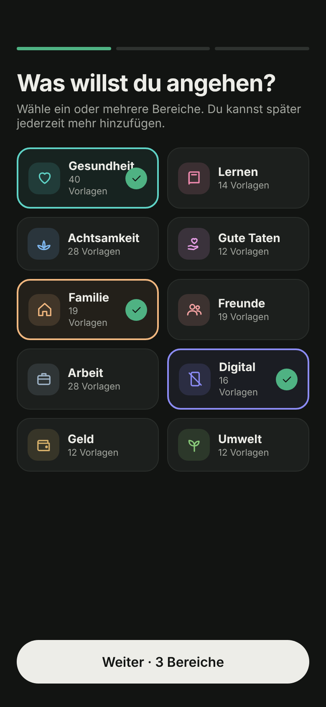
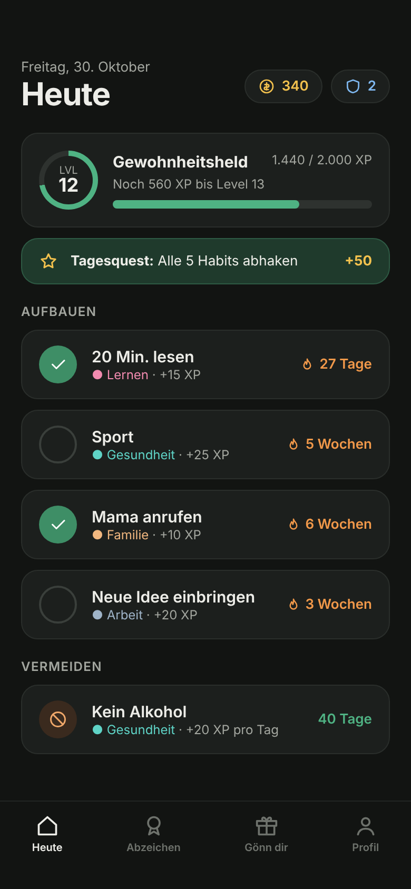
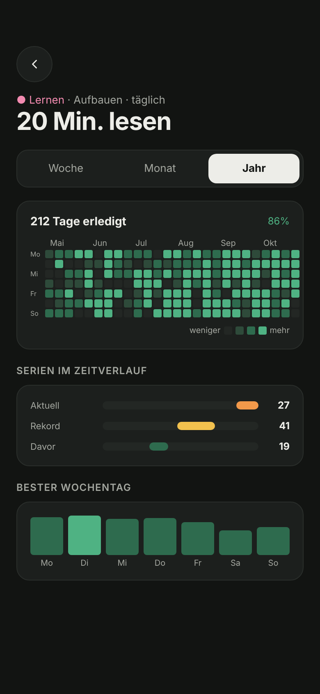
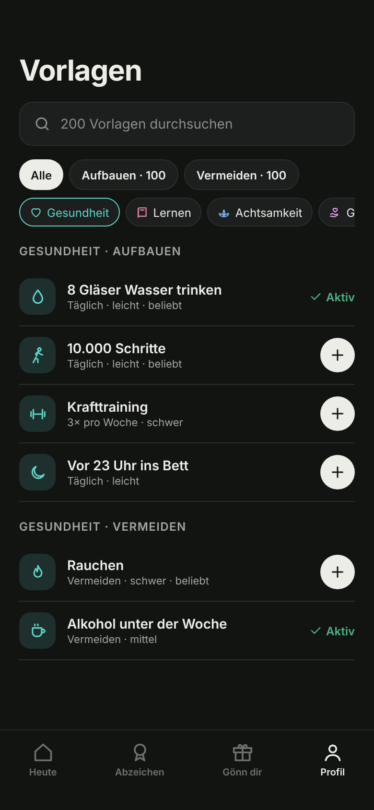
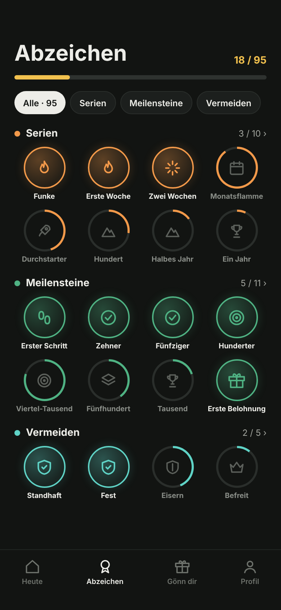
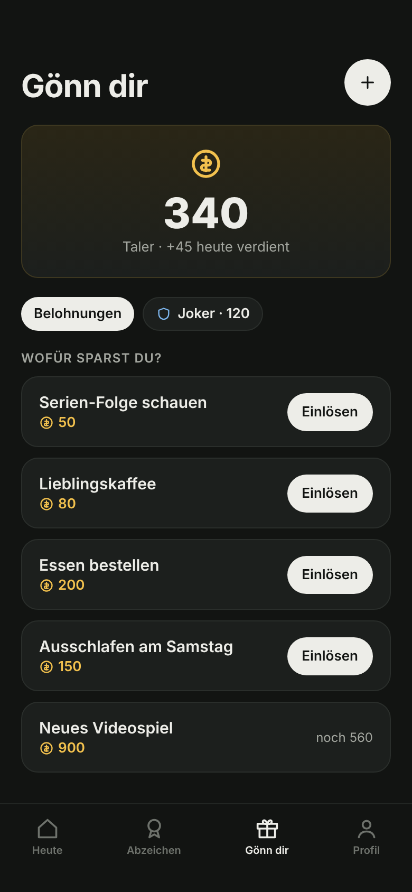

# habitd

A lightweight, self-hosted habit tracker with rewards. Build good habits, break bad ones, and treat yourself when you stick with it. Runs as a single Docker container.

<p>
  
  
  
</p>
<p>
  
  
  
</p>

The screenshots are the design mockups. The UI language is German.

## Features

- **Guided start:** a short onboarding and 200 ready-made habit templates with search
- **Habits to build or avoid:** daily, n times per week or month, or on chosen weekdays, with 7 days of backfill
- **Gamification:** XP, levels, titles, streak bonuses, a daily quest, and 95 badges in 16 categories
- **Jokers** that bridge a missed day, used automatically or by hand
- **Rewards** paid with coins ("Taler") or unlocked by a streak
- **Statistics:** week, month and year views with heatmap
- **PWA:** installable, with offline shell and Web Push reminders
- **JSON export and import**, plus a small JSON API
- **Private:** no external services, no tracking, all assets are embedded

It ships as a 28 MB image and uses about 5 MB of RAM when idle.

## Quick start

```sh
git clone https://github.com/seals187/habitd.git
cd habitd
cp .env.example .env    # set your user, password and port
docker compose up -d --build
```

Open <http://localhost:8080> (or your `HABITD_PORT`).

To try it with demo data, seed an empty database:

```sh
docker compose exec habitd /habitd seed
```

## Configuration

Set these in `.env`, Docker Compose picks them up.

| Variable | Default | Purpose |
|---|---|---|
| `HABITD_PORT` | `8080` | Port the app listens on, in the container and on the host |
| `HABITD_USER` | `admin` | Login name, applied on every start |
| `HABITD_PASSWORD` | `changeme` in Compose | Password, used only on the very first start. Without it, habitd shows a setup page. Change it later under Profil → Server |
| `HABITD_COOKIE_SECURE` | `true`, `false` in Compose | Set to `true` behind HTTPS |
| `HABITD_API_TOKEN` | empty | Bearer token for `/api/v1` |
| `HABITD_DB` | `/data/habitd.db` | Database path |
| `TZ` | system | Time zone; the day changes at 00:00 local time |

**Before exposing habitd:** set your own password and run it behind HTTPS with `HABITD_COOKIE_SECURE=true`. Service worker and Web Push need HTTPS or localhost. Everything else also works over plain HTTP.

On Linux hosts the `./data` folder must be writable by the container user:

```sh
mkdir -p data && sudo chown 65532:65532 data
```

## API

Use a session cookie or `Authorization: Bearer $HABITD_API_TOKEN`.

| Method | Path | Purpose |
|---|---|---|
| `GET` | `/api/v1/habits` | Active habits with streaks |
| `GET` | `/api/v1/checkins?from=2026-10-01&to=2026-10-31` | Check-ins |
| `POST` | `/api/v1/habits/{id}/checkins?date=2026-10-30` | Toggle a check-in (date optional) |
| `GET` | `/api/v1/stats` | Level, XP, coins, jokers and badges |

## Development

Requires Go 1.27.

```sh
make dev     # run locally on :8080, data in ./data
make test    # run all tests
make lint    # go vet and staticcheck
make build   # build bin/habitd
make docker  # build the image
make seed    # demo data for make dev
```

Stack: Go `net/http`, SQLite via `modernc.org/sqlite` (no CGO), `html/template`, HTMX, Alpine.js (CSP build) and one hand-written CSS file. There is no build step. Game rules live in `internal/game`, free of I/O. Design decisions are in [docs/DECISIONS.md](docs/DECISIONS.md).

## Credits

[htmx](https://htmx.org) (0BSD), [Alpine.js](https://alpinejs.dev) (MIT), [Lucide](https://lucide.dev) icons (ISC), [Inter](https://rsms.me/inter/) font (OFL).

## License

[AGPL-3.0](LICENSE)
