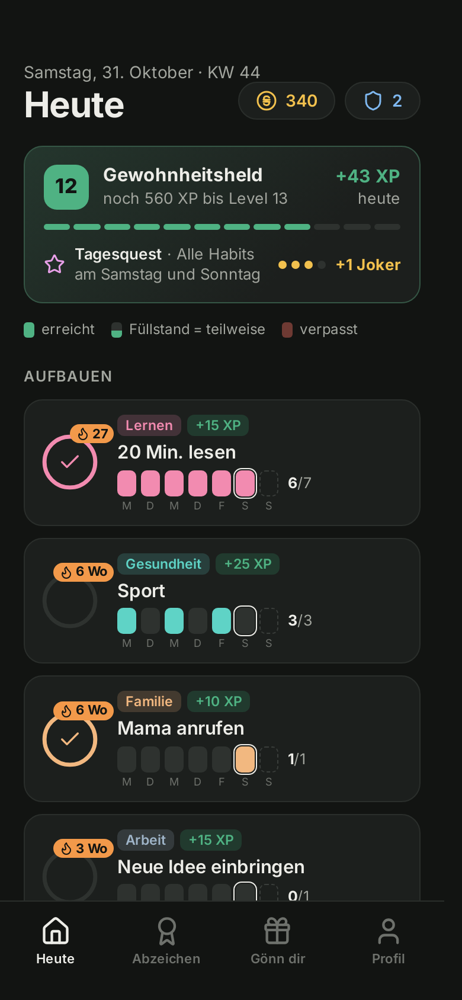
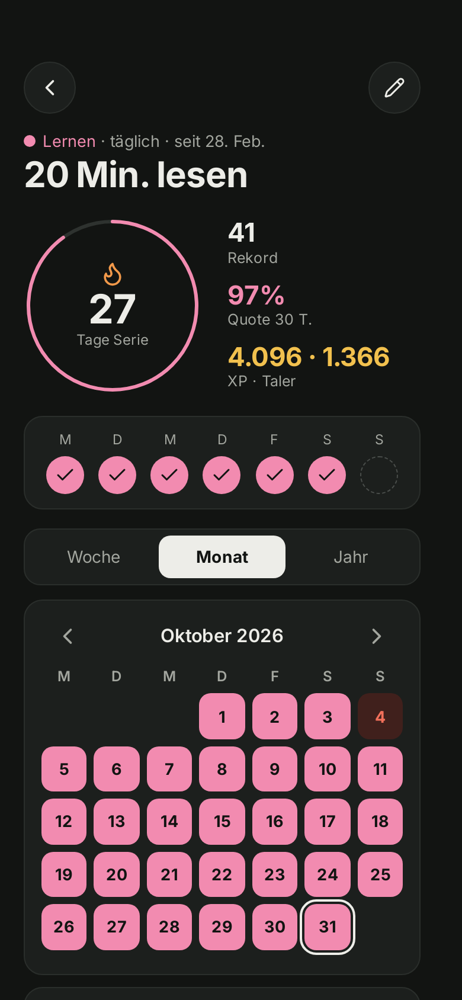
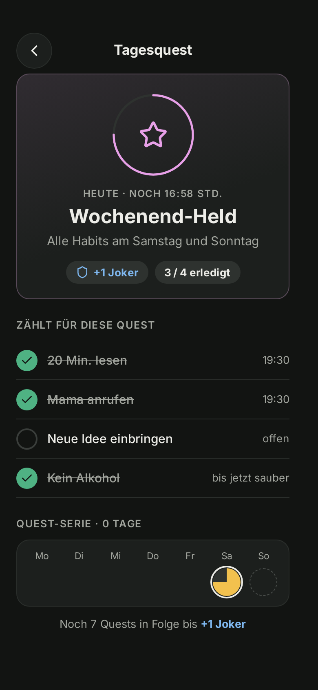
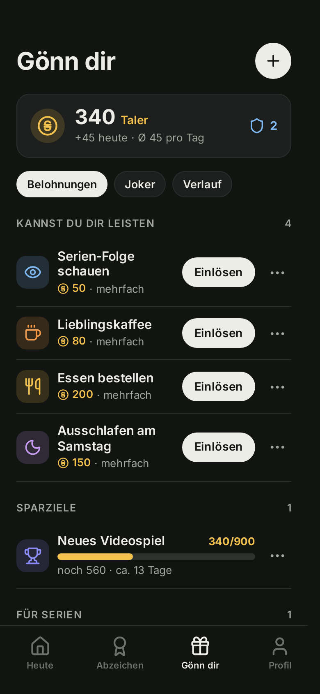
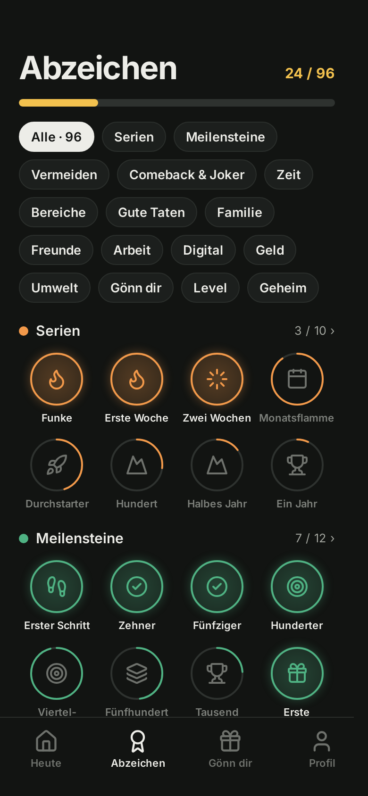
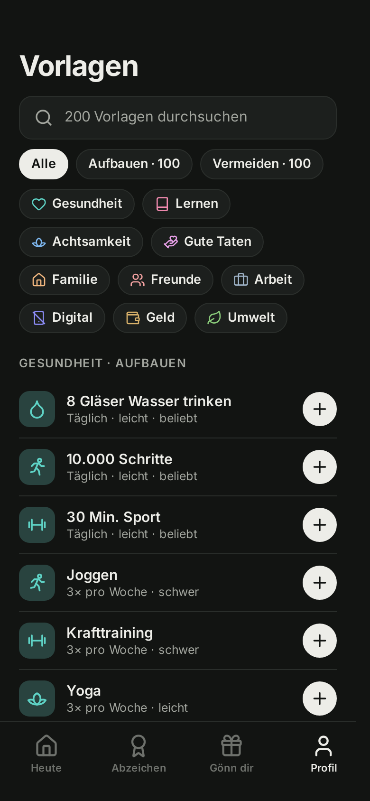
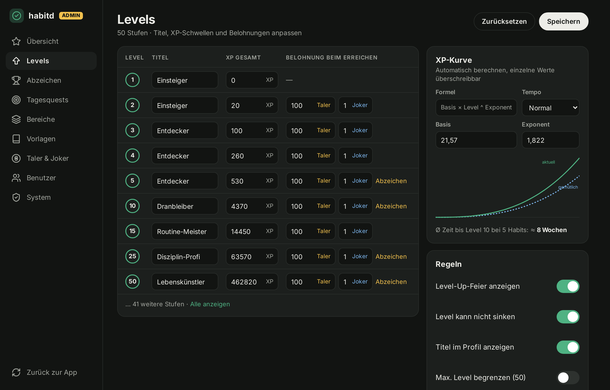
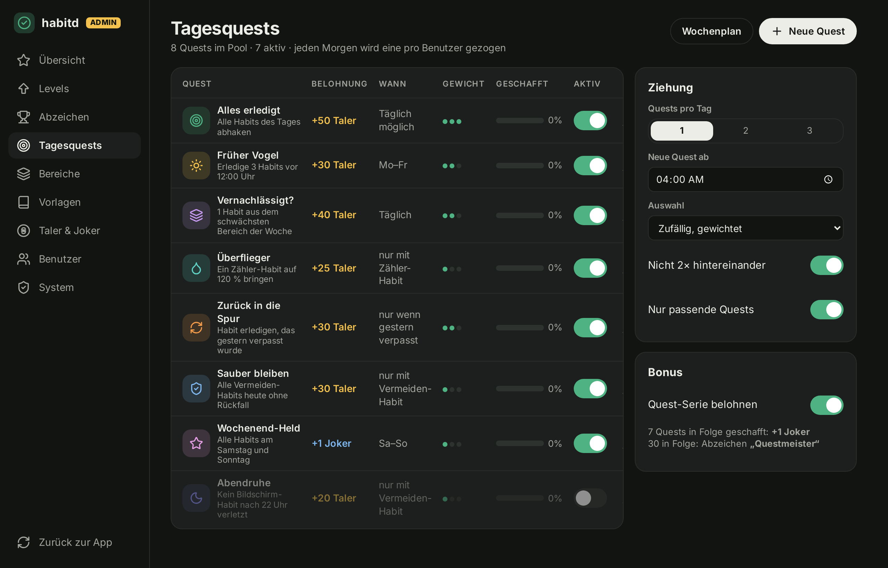

# habitd

A lightweight, self-hosted habit tracker with rewards. Build good habits, break bad ones, and treat yourself when you stick with it. Runs as a single Docker container.

<p>
  
  
  
</p>
<p>
  
  
  
</p>
<p>
  
  
</p>

The screenshots show the app with demo data. The UI language is German.

## Features

- **Guided start:** a short onboarding and 200 ready-made habit templates with search
- **Habits to build or avoid:** daily, n times per week or month, or on chosen weekdays, with 7 days of backfill
- **Gamification:** XP, levels, titles, streak bonuses, configurable daily quests, and 96 badges in 16 categories
- **Jokers** that bridge a missed day, used automatically or by hand
- **Rewards** paid with coins ("Taler") or unlocked by a streak
- **Statistics:** week, month and year views with heatmap
- **PWA:** installable, with offline shell and Web Push reminders
- **JSON export and import**, plus a small JSON API
- **Several users:** roles, invite links, private data per user and an admin area for levels and badges
- **Private:** no external services, no tracking, all assets are embedded

It ships as a 28 MB image and uses about 5 MB of RAM when idle.

## Quick start

```sh
git clone https://github.com/seals187/habitd.git
cd habitd
cp .env.example .env    # set your port and, if you like, the first admin
mkdir -p data && sudo chown -R 65532:65532 data    # Linux only
docker compose pull
docker compose up -d
```

The image comes from `ghcr.io/seals187/habitd`. To build it from source instead, run `docker compose up -d --build`.

Open <http://localhost:8080> (or your `HABITD_PORT`) and create the first account.

To try it with demo data, seed an empty database:

```sh
docker compose exec habitd /habitd seed
```

## First start and admin

The first admin comes from one of these sources:

1. **Environment.** If `HABITD_ADMIN_USER` and `HABITD_ADMIN_PASSWORD` are set and no user exists, this account is created on start and the setup page stays closed. The variables only count on the very first start. Change the password in the app afterwards.
2. **Setup page.** Without those variables every page leads to `/setup`, and the first account created there becomes the admin. Afterwards `/setup` answers 404 for good.

An older single-user installation becomes user 1 with the same login. All data stays with it, and habitd writes a copy to `/data/habitd.db.bak-<timestamp>` before it migrates.

The container runs as user 65532. On Linux hosts the data folder must belong to it, otherwise habitd stops with `unable to open database file`:

```sh
chown -R 65532:65532 ./data
```

**More users:** admins create accounts or invite links (valid for 7 days, single use) under Profil → Administration → Benutzer. Open registration is off unless `HABITD_ALLOW_SIGNUP=true`. Everyone sees only their own data. Admins see figures of other users, never their habits.

**Locked out?** These commands work on the database, also while the server runs:

```sh
docker compose exec habitd /habitd admin list
docker compose exec habitd /habitd admin create <user> [--admin]
docker compose exec habitd /habitd admin reset-password <user>    # prints a random password
docker compose exec habitd /habitd admin promote <user>
docker compose exec habitd /habitd admin demote <user>            # refused for the last admin
```

## Configuration

Set these in `.env`, Docker Compose picks them up.

| Variable | Default | Purpose |
|---|---|---|
| `HABITD_PORT` | `8080` | Port the app listens on, in the container and on the host |
| `HABITD_ADMIN_USER` | `admin` | Name of the first admin, first start only |
| `HABITD_ADMIN_PASSWORD` | empty | Password of the first admin, first start only. Without it, habitd shows a setup page |
| `HABITD_ALLOW_SIGNUP` | `false` | Open registration, new accounts get the role `user` |
| `HABITD_INSECURE_COOKIES` | `false` | Set to `true` for plain HTTP, the session cookie then is not `Secure` |
| `HABITD_API_TOKEN` | empty | Bearer token for `/api/v1`, it acts as the first active admin |
| `HABITD_DB` | `/data/habitd.db` | Database path |
| `TZ` | system | Time zone; the day changes at 00:00 local time |
| `HABITD_PASSWORD`, `HABITD_USER` | empty | Deprecated names of the admin variables |
| `HABITD_COOKIE_SECURE` | `true`, `false` in Compose | Deprecated, `false` works like `HABITD_INSECURE_COOKIES=true` |

**Before exposing habitd:** run it behind HTTPS with `HABITD_COOKIE_SECURE=true` in `.env`, Compose defaults to plain HTTP. Service worker and Web Push need HTTPS or localhost. Everything else also works over plain HTTP.

## API

Use a session cookie or `Authorization: Bearer $HABITD_API_TOKEN`.

| Method | Path | Purpose |
|---|---|---|
| `GET` | `/api/v1/habits` | Active habits with streaks |
| `GET` | `/api/v1/checkins?from=2026-10-01&to=2026-10-31` | Check-ins |
| `POST` | `/api/v1/habits/{id}/checkins?date=2026-10-30` | Toggle a check-in (date optional) |
| `GET` | `/api/v1/stats` | Level, XP, coins, jokers and badges |

## Development

Requires Go 1.27.

```sh
make dev     # run locally on :8080, data in ./data
make test    # run all tests
make lint    # go vet and staticcheck
make build   # build bin/habitd
make docker  # build the image
make seed    # demo data for make dev
```

Stack: Go `net/http`, SQLite via `modernc.org/sqlite` (no CGO), `html/template`, HTMX, Alpine.js (CSP build) and one hand-written CSS file. There is no build step. Game rules live in `internal/game`, free of I/O. Design decisions are in [docs/DECISIONS.md](docs/DECISIONS.md).

## Credits

[htmx](https://htmx.org) (0BSD), [Alpine.js](https://alpinejs.dev) (MIT), [Lucide](https://lucide.dev) icons (ISC), [Inter](https://rsms.me/inter/) font (OFL).

## License

[AGPL-3.0](LICENSE)
